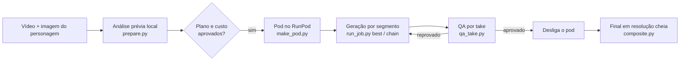

<div align="center">

# H3 Character Swap

**Skill de agente que troca a pessoa de um vídeo por um personagem de imagem de referência, mantendo cena, performance, fala e áudio originais.**

[](#visao-tecnica)
[](#visao-tecnica)
[](#requisitos)
[](#requisitos)
[](https://github.com/VIDORETTO/dev-skills/commits/main)

[Sobre](#sobre) · [Como funciona](#como-funciona) · [Instalação](#instalacao) · [Uso](#uso) · [LoRA alternativo](#lora-alternativo) · [Limitações](#limitacoes)

</div>

<a id="sobre"></a>

## 📖 Sobre

`h3-character-swap` é uma skill (pasta com [`SKILL.md`](./SKILL.md), referências e scripts) para um agente de IA conduzir uma troca de personagem em vídeo de ponta a ponta. Você entrega um vídeo e uma imagem do personagem; o agente prepara tudo na sua máquina, aluga uma GPU no RunPod pelo tempo mínimo, gera o vídeo com o MiniMax H3 e o LoRA Character Swap v1.5 do akatz, mede o resultado com números e devolve o vídeo final com o áudio original.

O personagem herda a performance da pessoa original (pose, olhar, fala, timing e movimento de câmera). O fundo fica igual ao da fonte. Trechos em que a pessoa sai de quadro ficam com o vídeo original.

A receita foi validada em quatro rodadas reais, descritas em [`references/11-caso-sherlock.md`](./references/11-caso-sherlock.md). Cada regra da skill existe porque a sua ausência já estragou um resultado; o registro está em [`references/10-falhas.md`](./references/10-falhas.md).

**Use quando** quiser substituir uma pessoa de um vídeo por um personagem dado em imagem (realista, ilustrado ou 3D), preservando o que ela fala e faz.

## ✨ Recursos

- **Análise prévia grátis, na CPU:** conversão de HDR (iPhone/Android) para SDR, voz isolada com Demucs, transcrição com faster-whisper, detecção de sons sem palavra (sopro, riso, respiração), presença da pessoa por frame, cortes de câmera e divisão em segmentos de ~4–6,5 s nas pausas da fala.
- **Estimativa de custo e aprovação** antes de ligar qualquer GPU.
- **Pod pronto em poucos minutos:** `make_pod.py` monta o boot que contorna as armadilhas conhecidas do template do RunPod e fixa a versão validada da ferramenta oficial.
- **Geração por segmentos** com máscara SAM 3.1 (o fundo não é regenerado), prompt por segmento com o diálogo transcrito e as ações não verbais com tempo, e 18 frames de histórico entre segmentos.
- **Best-of-N automático:** várias seeds por segmento, QA em cada take e escolha pela maior nota.
- **QA objetiva:** lip sync contra a fonte (MediaPipe) e contra o áudio (SyncNet), identidade contra a referência e contra a pessoa original (ArcFace), recorte da máscara e cor do fundo.
- **Final em resolução cheia:** o personagem é colado sobre o vídeo original, com o fundo idêntico ao da fonte.
- **Custo zerado no fim:** o agente desliga o pod e confere que não sobrou cobrança parada.
- **Alavancas experimentais** para quando a receita padrão não bastar: guia de profundidade/face mesh no estilo Genjutsu, reparo de boca com LatentSync, âncoras de frame e referência extra do personagem.

<a id="como-funciona"></a>

## 🧠 Como funciona



1. **Análise (CPU, grátis):** o agente prepara os clipes, transcreve a fala, marca os sons sem palavra e escreve um relatório com shots, segmentos, riscos e custo estimado.
2. **Você aprova** o plano e o custo e, se algum shot pedir âncora, escolhe se você mesmo a faz no Nano Banana / GPT Image ou se a IA faz com o Qwen.
3. **GPU curta:** o agente cria o pod, gera 2–3 seeds do primeiro segmento de cada shot, fica com o melhor pela QA e encadeia o resto.
4. **Entrega:** desliga o pod, monta o vídeo final em resolução cheia com o áudio original e reporta os números (lip sync, identidade, cor, custo).

<a id="requisitos"></a>

## 📋 Requisitos

| Item | Detalhe |
|---|---|
| Agente | Um host que carregue skills no formato `SKILL.md` |
| RunPod | Conta com saldo e o MCP do RunPod conectado ao agente (ferramentas `create-pod`, `delete-pod`, `list-pods`) |
| GPU | RTX PRO 6000 Blackwell (96 GB) por padrão; H100/H200 (80 GB+) como alternativa. A RTX 5090 (32 GB) não comporta 768p |
| ffmpeg | Build *full*, com `zscale` (libzimg). No Windows: `winget install Gyan.FFmpeg` |
| Python | 3.10+ para `run_job.py`, `make_pod.py` e `assemble.py` (só biblioteca padrão) |
| Venv local | Python 3.12 com rembg, OpenCV, MediaPipe, Demucs, faster-whisper e InsightFace, para a análise, a QA e o composite |

<a id="instalacao"></a>

## 📦 Instalação

1. Copie a pasta `h3-character-swap/` para o diretório de skills do seu agente (por exemplo `~/.claude/skills/`, `~/.agents/skills/`, `~/.codex/skills/` ou `~/.cursor/skills/`). O nome declarado é `h3-character-swap`.
2. Crie o venv local (Windows/Git Bash, a configuração validada):

   ```bash
   PY312="$LOCALAPPDATA/Programs/Python/Python312/python.exe"
   "$PY312" -m venv "$LOCALAPPDATA/Temp/cswap-venv"
   V="$LOCALAPPDATA/Temp/cswap-venv/Scripts/python.exe"
   "$V" -m pip install "rembg[cpu]" opencv-python-headless mediapipe scipy soundfile
   "$V" -m pip install torch torchaudio --index-url https://download.pytorch.org/whl/cpu
   "$V" -m pip install demucs faster-whisper
   "$V" -m pip install insightface onnxruntime python_speech_features
   ```

   Opcional, só para o guia de profundidade: `"$V" -m pip install transformers timm`. Detalhes e problemas conhecidos em [`references/08-ambiente-local.md`](./references/08-ambiente-local.md).
3. Confira: `ffmpeg -filters | grep zscale` deve listar o filtro, e `"$V" -c "import rembg, mediapipe, insightface"` não deve dar erro.

## 🚀 Início rápido

Peça ao agente, em linguagem natural:

> Troque a pessoa do vídeo `IMG_4882.MOV` pelo personagem de `sherlock.png`. É em português.

O agente carrega a skill, roda a análise prévia e volta com um relatório como este, antes de gastar qualquer centavo:

```text
Análise prévia — IMG_4882.MOV
• Fonte: 1080x1920 24 fps 22,5 s · HDR→SDR · canvas 736x1344
• Shots: A (0–15,5 s) gerar · B (15,5–18,4 s) original, sem pessoa · C (18,4–22,5 s) gerar
• Riscos: close extremo (lip sync); chapéu maior que a cabeça (máscara 144 px)
• Plano: 3 seeds no A1 → escolher pela QA → encadear A2/A3 → C1 → montar
• Estimativa: ~40 min de GPU, ~US$ 1,70. Posso criar o pod?
```

Depois do seu OK, ele gera, mede, desliga o pod e entrega `final_full.mp4` com os números.

<a id="uso"></a>

## 🧑‍💻 Uso

O agente chama os scripts por você; os comandos abaixo servem para acompanhar ou rodar à mão. `S` = `scripts/`, `VPY` = python do venv, `JOB` = pasta do trabalho, `<pod>` = ID do pod (ou a URL de um ComfyUI, como `http://127.0.0.1:8188`).

| Etapa | Comando |
|---|---|
| Análise prévia | `VPY S/prepare.py --video <video> --character <ref.png> --out JOB --lang pt --res 768` |
| Conferir um prompt | `python S/run_job.py JOB/job.json prompt A1` |
| Criar o pod | `python S/make_pod.py` (JSON para a ferramenta `create-pod` do MCP) |
| Checar o pod | `python S/run_job.py JOB/job.json check <pod>` |
| Melhor de 3 seeds | `python S/run_job.py JOB/job.json best <pod> A1 11,22,33` |
| Âncora feita por você (Nano Banana / GPT Image) | `python S/anchor_kit.py JOB/job.json A`, siga `JOB/anchor_kit/COMO_FAZER.md`, devolva em `JOB/anchors_user/` e rode `VPY S/qa_anchor.py JOB/job.json A --set` |
| Âncora feita pela IA (Qwen no pod `--qwen`) | `python S/run_job.py JOB/job.json anchor <pod> A 11,22,33` e depois `VPY S/qa_anchor.py JOB/job.json A --set` |
| Trocar o take escolhido | `python S/run_job.py JOB/job.json select A1 A1_s22` |
| Encadear o shot | `python S/run_job.py JOB/job.json chain <pod> A [--seeds 11,22]` |
| QA de um take | `VPY S/qa_take.py JOB/job.json A1 A1_s22` |
| Montagem de QA (canvas) | `python S/assemble.py JOB/job.json JOB/final.mp4` |
| Final em resolução cheia | `VPY S/composite.py JOB/job.json JOB/final_full.mp4 --debug-mask` |

O passo a passo completo, com os gates de cada fase, está em [`references/01-pipeline.md`](./references/01-pipeline.md). Como ler cada número da QA: [`references/09-qa.md`](./references/09-qa.md).

### Quando a receita padrão não basta

A tabela "Decisões rápidas" do [`SKILL.md`](./SKILL.md) cobre os casos comuns. Em ordem de custo:

1. **Mais seeds** (`best` com 3–5 seeds). É a alavanca mais barata e a de maior efeito.
2. **Descrever melhor a boca** no `behavior` do segmento (sopro, pausas, boca pequena).
3. **Máscara maior** para chapéu, cabelo armado ou capa (`expansion_px` 144–160).
4. **Base sem Turbo** (`--no-turbo`) em closes difíceis.
5. **Âncora de 1º frame** (o frame da fonte já com o personagem) em planos médios/abertos. Antes do pod, o agente pergunta se você prefere fazer no Nano Banana ou no GPT Image (ele prepara o frame, o prompt e o passo a passo) ou se ele faz com o Qwen no pod: [`references/05-ancora.md`](./references/05-ancora.md).
6. **Alavancas experimentais:** guia de profundidade ([`references/16-guia-profundidade.md`](./references/16-guia-profundidade.md)), referência extra, âncora no meio do shot, `lipfix`.
7. **Trocar de LoRA**: veja a seção seguinte.

<a id="lora-alternativo"></a>

## 🔀 LoRA alternativo: Alissonerdx v1.1

A skill usa o **LoRA Character Swap v1.5 do akatz**, com a ferramenta oficial dele. Existe outro LoRA de character swap para o mesmo modelo, o **Alissonerdx Character Swap v1.1**, focado em deixar o personagem mais parecido com a referência. Ele é uma **alternativa** para quando o do akatz não estiver bom no seu vídeo, não uma substituição automática.

**Links:**
- Repositório (model card, LoRAs, docs, workflows): [huggingface.co/Alissonerdx/Minimax-H3-ComfyUI](https://huggingface.co/Alissonerdx/Minimax-H3-ComfyUI)
- Arquivo do LoRA: [`loras/minimax_h3_character_swap_v1.1_ref2va_fro.safetensors`](https://huggingface.co/Alissonerdx/Minimax-H3-ComfyUI/blob/main/loras/minimax_h3_character_swap_v1.1_ref2va_fro.safetensors)
- Guia oficial: [`docs/character-swap.md`](https://huggingface.co/Alissonerdx/Minimax-H3-ComfyUI/blob/main/docs/character-swap.md) · workflow: [`minimax_h3_character_swap_workflow.json`](https://huggingface.co/Alissonerdx/Minimax-H3-ComfyUI/blob/main/workflows/minimax_h3_character_swap_workflow.json)
- Lançamento do v1.1 (18/10/2026): [comfyui-wiki](https://comfyui-wiki.com/en/news/2026-10-18-h3-character-swap-v1-1) · [ArtRealm](https://artrealmai.com/article/minimax-h3-character-swap-lora-v1-1-comfyui)

| | akatz v1.5 (padrão da skill) | Alissonerdx v1.1 (alternativa) |
|---|---|---|
| Como o vídeo-fonte entra | Como referência (`<Video 1>`) | Como guia alinhado à saída, posição por posição (`MiniMaxH3AddGuide`) |
| Foco declarado | Preservar cena, fala e cortes | Semelhança com a referência (rosto, cabelo, corpo, roupa) |
| Prompt | Livre, com diálogo `<d>` e `behavior` com tempos | Fixo, uma linha com o gatilho `body_swap:` e a lista de atributos |
| Máscara / fundo | SAM 3.1; fora da máscara o fundo é preservado | BiRefNet; não preserva o fundo do mesmo jeito (o `composite.py` devolve o fundo original de qualquer forma) |
| Turbo | lightx2v 8 steps | DMD 8 steps |
| Licença do LoRA | Licença do MiniMax H3 | Própria: uso comercial livre, **proibido oferecer como API/SaaS** (a licença do H3 base continua valendo) |
| Validação nesta skill | Caso real: lip sync 0,71–0,82 | Nenhuma ainda |

### Quando compensa trocar

**Compensa testar** quando o problema é **semelhança**, não boca nem fundo: depois de 3+ seeds e dos ajustes da lista anterior, o `qa_identity.py` mostra `id_ref` baixo ou margem pequena contra a pessoa original, ou o figurino e o cabelo saem diferentes da referência. Vale mais em plano médio ou aberto, com uma pessoa só e sem cortes dentro do segmento.

**Provavelmente não compensa** quando o problema é **lip sync** (o v1.1 não recebe o diálogo no prompt; a receita do akatz tem números reais), quando há várias pessoas na cena, cortes de câmera dentro do segmento, rostos muito pequenos ou oclusão forte, ou quando a troca vai ser oferecida como API/SaaS.

### O que dizem os relatos

- **O autor** chama o modelo de experimental, "not a guaranteed identity-transfer system". Segundo ele, a semelhança afrouxa com rostos pequenos, oclusão, movimento rápido, ângulos difíceis, mudanças de luz e clipes longos. Ele sugere combinar com o Head Swap LoRA do mesmo repositório para melhorar o lip sync em alguns clipes, e disse que pretende fazer uma versão melhor junto com o akatz.
- **A v1.1** (80 MB, extração SVD) respondeu à reclamação principal da v1.0 (620 MB): o personagem não ficava parecido o bastante com a referência.
- **Nenhuma comparação independente com o akatz v1.5** foi encontrada, nem relato de usuário específico sobre a v1.1. Por isso a decisão é por A/B com a QA da skill.

**Como testar:** A/B no primeiro segmento, com 2–3 seeds dos dois lados, medindo com o `qa_take.py`; adote só se ganhar em identidade **sem** perder lip sync. Os dois LoRAs não devem ser empilhados.

> **Ainda não integrado aos scripts.** O v1.1 usa outro grafo e outro formato de prompt, então trocar só o arquivo do LoRA no `job.json` não funciona. O grafo precisa ser montado a partir da documentação oficial dele. Todos os detalhes, os relatos e o passo a passo do teste estão em [`references/19-lora-alissonerdx.md`](./references/19-lora-alissonerdx.md).

## 🛠️ Solução de problemas

| Sintoma | Causa provável | O que fazer |
|---|---|---|
| Cores lavadas ou escuras e contrastadas | Vídeo HDR (iPhone/Android) não convertido | O `prepare.py` converte; se o SDR ficar escuro, subir `npl` para 300–400 ([`02`](./references/02-preprocessamento.md)) |
| Personagem aparece numa cena sem ninguém | Trecho sem pessoa marcado como `generate` | Conferir os shots `preserve` no `analysis.md` |
| Chapéu ou cabelo cortado | Máscara menor que o figurino | `expansion_px` 144–160 e `qa_mask.py` ([`04`](./references/04-mascara.md)) |
| Boca não acompanha a fala | Seed ruim, `behavior` vago ou trecho sem diálogo transcrito | `best` com mais seeds; descrever sopros e pausas; revisar `dialogue` |
| "Não trocou nada" | Saída lida do nó errado | O `run_job.py` lê só o nó 807; não baixar a saída à mão |
| Lista de modelos vazia ou OOM no pod | Armadilhas do template | Usar sempre o `make_pod.py` ([`07`](./references/07-runpod.md)) |
| `assemble`/`composite` recusam montar | Take de continuação gerado com o histórico de outro take | Rodar `chain` de novo; ele regera só o que ficou inválido |

O registro completo de falhas e correções está em [`references/10-falhas.md`](./references/10-falhas.md).

---

# 🔧 Documentação técnica

<a id="visao-tecnica"></a>

## 🏗️ Visão técnica

| Camada | Tecnologia |
|---|---|
| Modelo de vídeo | MiniMax H3 `ref2va` (DiT int8), text encoder Qwen3-VL 32B `nvfp4_awq`, VAEs de vídeo e áudio |
| Troca de personagem | LoRA `h3_character_swap_v1.5` (akatz) + Turbo lightx2v 8-step |
| Máscara | SAM 3.1 (nativo do ComfyUI) |
| Orquestração na GPU | ComfyUI com os nós da `akatz-labs/h3-character-swap-tool`, fixada no commit `0670e4fdf95a` |
| Infra | RunPod (template `bii5d425kp`, sem volume persistente) |
| Local | ffmpeg, Demucs, faster-whisper, rembg, MediaPipe, InsightFace; SyncNet e Depth Anything/MiDaS opcionais |

Modelos, sampler, janelas e memória: [`references/06-parametros.md`](./references/06-parametros.md). IDs dos nós e modo segmento: [`references/12-api-comfyui.md`](./references/12-api-comfyui.md).

## 📁 Estrutura

```text
h3-character-swap/
├── SKILL.md           # entrada da skill: regras de ouro, fluxo, decisões rápidas
├── README.md          # este arquivo
├── assets/            # grafo oficial (API JSON), prompt estruturado do akatz, transcrição de exemplo
├── references/        # 00–19: análise, pipeline, prompt, máscara, âncora, QA, falhas, caso real, fronteira…
└── scripts/
    ├── prepare.py         # análise prévia local
    ├── make_pod.py        # JSON do create-pod com o boot pronto
    ├── run_job.py         # check, prompt, anchor, seg, best, select, chain, lipfix
    ├── assemble.py        # final no canvas, para QA
    ├── composite.py       # final em resolução cheia sobre o vídeo original
    ├── make_guide.py      # clipes-guia de profundidade/face mesh (experimental)
    ├── qa_take.py         # QA completa de um take, com nota
    ├── anchor_kit.py      # pacote para você fazer a âncora no Nano Banana / GPT Image
    ├── qa_anchor.py       # alinha, mede, cola de volta e escolhe a melhor âncora de frame
    ├── qa_lipsync.py      # boca gerada x boca da fonte
    ├── qa_syncnet.py      # boca gerada x áudio (SyncNet)
    ├── qa_identity.py     # identidade (ArcFace/DINOv2)
    ├── qa_mask.py         # recorte da máscara
    ├── qa_color.py        # cor do fundo
    └── h3common.py        # utilitários compartilhados
```

## 🔄 Fluxo interno de um segmento

```text
clips/<seg>.mp4 (voz isolada) ─┐
imagem do personagem ──────────┼─► grafo oficial (nós 1–807) ─► out/<seg>_s<seed>.mp4
histórico do take anterior ────┘        │                          │
                                        └─► hist_<take>.npz        └─► qa_take.py ─► nota ─► select
```

Cada continuação registra no `job.json` de qual take do segmento anterior saiu (`history_from`); trocar um take desmarca os seguintes que dependiam dele.

## 🧪 Testes

Não há suíte automatizada. As validações registradas são:

- **Caso real completo** (4 rodadas, com números): [`references/11-caso-sherlock.md`](./references/11-caso-sherlock.md).
- **Melhorias de 21/10/2026:** testadas em CPU com vídeos reais de rosto (identidade, composite, máscara, prepare) e contra um ComfyUI simulado (grafos, best-of-N, histórico, lipfix). O status de cada alavanca está em [`references/15-fronteira.md`](./references/15-fronteira.md).

<a id="limitacoes"></a>

## ⚠️ Limitações

- **O LoRA v1.5 é experimental:** identidade, timing, expressões, oclusões e cortes podem desviar. Os resultados dependem muito da seed.
- **Lip sync bom, não perfeito:** 0,71–0,82 no caso real, com trechos fracos quando a pessoa original quase não abre a boca.
- **Segmentos curtos:** acima de ~10 s por janela o LoRA perde identidade e lip sync; por isso a skill corta em ~4–6,5 s.
- **Saída a 24 fps**, a taxa nativa do H3.
- **Recursos experimentais** (guia de profundidade, `lipfix`, referência extra, âncora no meio do shot, SyncNet na nota) ainda não rodaram numa geração real em GPU.
- **Ferramenta fixada** num commit anterior ao Relay 2.0; plano de migração em [`references/18-migracao-relay2.md`](./references/18-migracao-relay2.md).
- **Licença do modelo:** MiniMax H3 Community License, com restrições territoriais (EUA, UE, Reino Unido e Coreia do Sul fora da concessão padrão) e de uso comercial.
- **Pessoas reais:** trocar a identidade de alguém pode enganar. Confirme consentimento e propósito quando o personagem for uma pessoa real identificável.

## 🙏 Créditos e fontes

- LoRA e ferramenta: [akatz-ai/MiniMax-H3-Character-Swap-LoRA](https://huggingface.co/akatz-ai/MiniMax-H3-Character-Swap-LoRA) e [akatz-labs/h3-character-swap-tool](https://github.com/akatz-labs/h3-character-swap-tool).
- Modelo: [MiniMax H3](https://huggingface.co/MiniMaxAI/MiniMax-H3) e os arquivos do [Comfy-Org](https://huggingface.co/Comfy-Org/MiniMax-H3).
- Lista completa de fontes oficiais e da comunidade: [`references/14-fontes.md`](./references/14-fontes.md).

## 📄 Licença

Nenhum arquivo `LICENSE` foi encontrado neste repositório; os termos de uso e redistribuição da skill não estão declarados. Os modelos usados têm licenças próprias (veja [Limitações](#limitacoes)).
